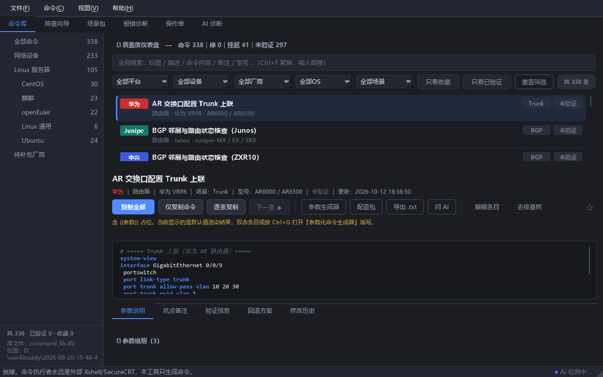
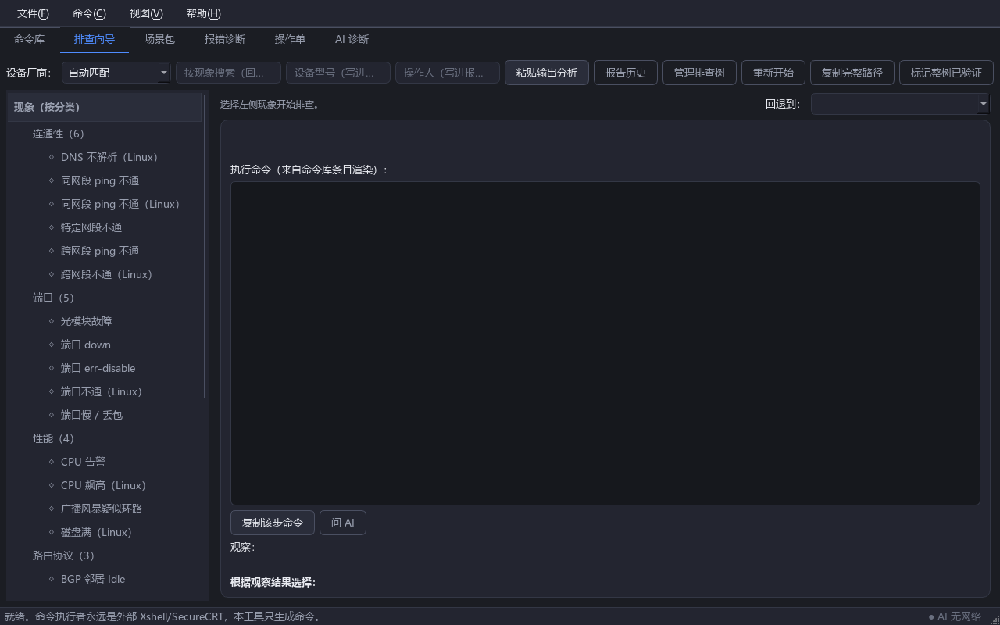
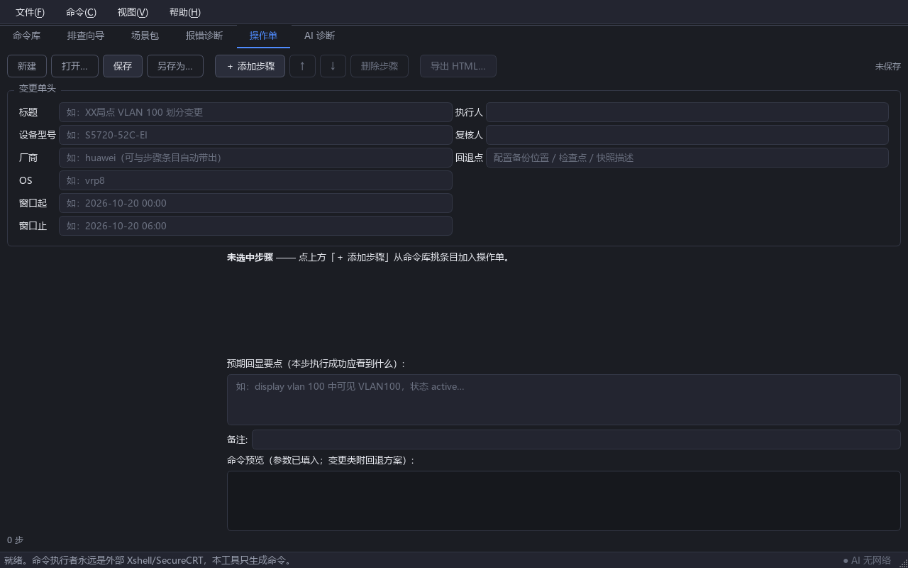
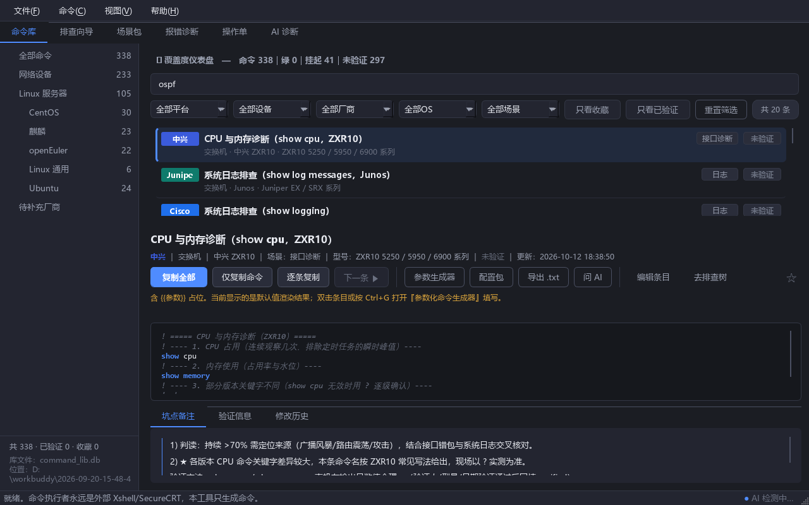
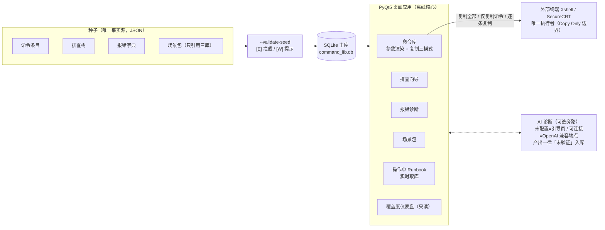

# NetToolBox —— 离网网络运维的操作安全工具箱



**NetToolBox 是一台可以装进 U 盘的离线网络运维知识库**：把 10 家网络厂商与 4 个 Linux 发行版的常用命令、排查树、报错判读沉淀为本地 SQLite 知识库，不联网、不依赖云服务。它围绕三个操作安全支柱设计——**每条命令带验证状态、变更类命令必带回退方案（rollback）、工具只生成与复制命令而绝不代替你执行（Copy Only）**。

## Why NetToolBox

### Offline First —— 为「无网可用」而生

机房、客户现场、割接窗口，网络往往就是不可用的原因。NetToolBox 的全部核心能力离线完成：

- **零联网运行**：SQLite 主库 + JSON 种子全本地，拷进 U 盘带走即可；附 `check_db.py` 只读体检脚本，受限环境可直接跑；
- **三库一体**：命令库（按「厂商 → OS → 场景」组织，`{{参数}}` 占位渲染、必填/选填校验）、报错诊断（粘贴设备回显，匹配报错字典给出原因与处理步骤）、排查树向导（见下文）；
- **Ctrl+K 全局命令面板**：任意页面一键唤起，一次输入同时搜三库，↑↓ 选择、Enter 跳转定位；空输入显示「最近使用」；
- **覆盖度仪表盘**：厂商×分类条目矩阵 + 三库四档验证进度分段条，全部 db 直查只读，口径见 [verify-guide](docs/verify-guide.md)。

### Operational Safety —— 先想好怎么退，再动手改

面向「命令是要贴到生产设备上跑的」这一现实设计：

- **验证状态如实标注**：每条命令带四档验证状态（真机验证 / 语法核对 / 挂起 / 未验证）与验证人、型号、日期字段，未验证条目明确标黄，不冒充可信结论；
- **变更类必带 rollback**：变更类条目内置回退序列（undo/no/delete 序列以「恢复变更前状态」为终点、复核命令收尾），详情页折叠面板展示；**复制变更类命令前弹确认弹窗**提示回退路径（查询类不弹，全局开关在「视图」菜单）；
- **种子入库硬校验**：`--validate-seed` 全量校验，**[E] 级一律拦截**（变更类缺 rollback、参数表缺字段等），[W] 级提示复核；
- **发版 zip 脱敏断言**：发版 zip 由 CI 组装，内置**正向白名单断言**（仅允许 exe / 主库 / 体检脚本 / 种子 JSON），配置、日志、会话文件混入即构建失败；
- **骨架条目复制守卫**：CLI 骨架（`exec_level: skeleton`）条目复制前拦截提示，防止半成品命令贴上设备。

### Knowledge-driven Troubleshooting —— 把老师傅的排查路径变成流程



排查树把故障场景拆成「**问题 → 检查 → 命令 → 预期结果 → 下一步**」的决策链：

- 每个步骤给出**观察点**（该看什么）与**检查命令**（按当前厂商从命令库实时渲染，覆盖 Cisco / 华为 / H3C / 锐捷 / 中兴 / Juniper 等六家）；
- 按观察结果走分支，直到叶子结论与处置清单——预置 26 棵树，覆盖连通性、端口、性能、路由协议、Linux、运维（防火墙 / 升级回滚 / AAA 等）；
- 报错诊断与之互补：设备报错回显粘贴进来，直接匹配报错字典（82 条）给出原因与处理步骤。

## 安全模型

- **离线核心**：不配置 AI、不联网，检索、渲染、参数化生成、排查树、操作单、场景包全部可用——AI 是可拆旁路，不是依赖项；
- **AI 旁路三种运行状态**：未配置时 AI Tab 显示引导页（不崩溃不报错）；配置缺失或无网络时置灰；可连接时经 OpenAI 兼容端点对话（状态栏常驻指示：绿=可连接 / 灰=无网络 / 黄=配置缺失）；
- **Copy Only 边界**：命令执行者永远是外部终端（Xshell / SecureCRT 等），本工具只生成、渲染与复制，**绝不代替你连接或下发设备**；AI 产出入库一律带「未验证」状态、仅可复制，不存在自动执行路径；
- **密钥存储现状**：AI 的 `api_key` 以明文保存在程序同目录 `ai_config.json`（该文件不入 git、且被发版 zip 白名单断言排除，不会随包分发）——介意明文落盘的环境请勿配置 AI，离线核心不受影响；
- **复制三模式**：复制全部（含注释整块）/ 仅复制命令（剔除 `!` `#` 注释行，粘贴即跑）/ 逐条复制（逐条高亮回车下一条，精确定位单条命令）。

## 典型场景

### 场景一：OSPF 邻居卡在 ExStart —— 按排查树走查

1. 排查向导选择现象「OSPF 邻居卡 ExStart」（路由协议类，覆盖六家厂商）；
2. **步骤 1 · 确认邻居状态**：树给出各厂商检查命令（Cisco `show ip ospf neighbor` 族 / 华为 `display ospf peer` 族等，按当前厂商渲染），观察邻居卡在哪个状态；
3. 观察到 **ExStart/Exchange** → 进入 **步骤 2 · MTU 与 DBD 协商**：核对两端接口 MTU 是否一致、中间链路是否透传 DBD 包——命中叶子结论「MTU 不一致」即给出处置清单；
4. 观察到 **Init** → 走「Hello 单向可达」分支；**无邻居** → 走「宣告与参数核对」分支（网段宣告、区域号、Hello/Dead、认证逐项比对）。

每一步都是「该看什么 → 贴哪条命令 → 预期结果 → 下一步去哪」，新人也能按树走查。

### 场景二：变更窗口前 —— 先出操作单（Runbook）



1. **生成**：操作单生成器从三库逐条组装步骤，参数化生成命令，填写变更单头（标题 / 设备 / 厂商 / 窗口起止 / 执行人 / 复核人 / 回退点）；
2. **回退审查**：变更类步骤自动附回退方案（实时取库、不落盘防漂移），导出的单文件 HTML 含**回退方案汇总页**——窗口开始前先把「怎么退」过一遍；
3. **执行**：A4 打印友好版式带勾选框，逐步执行逐项打勾，复核命令收尾；
4. **验证**：附预期回显要点与复核签字页，执行完毕核对预期结果并归档操作单（本地存 `runbooks/`）。

操作单的完整使用说明（新建 / 填参 / 导出 HTML / 打印）见 [runbook-guide](docs/runbook-guide.md)。

同类的复用需求还有**场景包**：把命令 / 排查树 / 报错按场景组织成清单式捆绑（只引用不复制，条目变更由引用校验兜底），多厂商步骤支持按厂商视图切换——预置**新设备上架 / 割接前检查 / 故障应急回退**三包，见 [seed-guide 四·C](docs/seed-guide.md)。

## 快速开始

**方式一：下载成品（30 秒，免装环境）**

当前版本：**v0.8.0**（与程序「关于」对话框、Release 页保持一致；更新随 [Releases](../../releases) 发布，发版 zip 由 CI 自动构建挂载）。

到 [Releases](../../releases) 下载 `NetToolBox_v*.zip`，解压双击 `NetToolBox.exe` 即用：

```
NetToolBox.exe        # 双击运行
command_lib.db        # 命令主库（种子净库）
check_db.py           # 只读体检脚本（可选）
seed_data/            # 种子 JSON（重建/校验用）
```

**方式二：源码运行**

```bash
pip install -r requirements.txt   # PyQt5 + requests
python app/main.py                # 启动 GUI
python app/main.py --validate-seed   # 种子库质检（改种子后必跑）
python scripts/check_db.py        # 主库只读体检
```

常用快捷键：

| 快捷键 | 作用 | 快捷键 | 作用 |
|---|---|---|---|
| `Ctrl+K` | 全局搜索（三库） | `Ctrl+F` | 聚焦本库搜索 |
| `Ctrl+G` | 命令生成器 | `Ctrl+B` | 配置包 |
| `Ctrl+N` / `Ctrl+E` | 新建 / 编辑条目 | `Ctrl+L` | 库管理器 |
| `Ctrl+C` | 复制选中命令块 | `Ctrl+D` | 收藏切换 |

搜索状态实测：输入 `ospf` 即时过滤出 20 条相关条目，可按平台 / 设备 / 厂商 / OS / 场景继续收敛。



## 架构

种子是唯一事实源：改种子 → `--validate-seed` 全量校验 → 重建/更新主库；真机验证结论回流种子，形成「沉淀 → 验证 → 晋升」闭环。完整的数据流、三库职责与公开仓/伴生仓分工见 [docs/architecture.md](docs/architecture.md)。



## 种子规模

> 本节为随发版维护的事实段，数字与仓库种子实况核对一致。

| 库 | 数量 |
|---|---|
| 命令条目 | **338** |
| 排查树 | **26** 棵（防火墙 / Linux / 网络 / 运维） |
| 报错字典 | **82** 条 |
| 场景包 | **3** 个（新设备上架 / 割接前检查 / 故障应急回退） |

覆盖 **10 家网络厂商**（Cisco、华为 AR/S、H3C、Juniper、Palo Alto、Fortinet、锐捷、中兴、深信服、天融信）+ **Linux ×4**（CentOS 7 / 麒麟 V10 / openEuler 22.03 / Ubuntu 22.04），另有通用运维（转传工具类）条目。厂商与场景覆盖随验证会滚动扩充。

## 目录结构

```
app/            PyQt5 应用（入口 app/main.py）+ seed_data/ 种子库
scripts/        校验、体检与维护脚本（check_db / backup_db / hooks / build_exe 一键打包）
docs/           文档体系（索引 docs/README.md）：架构、种子指南、验证手册、部署说明、审计快照
lab/            compose 实验室：FRR / SR Linux / CentOS 7 / Ubuntu 四服务一键验证环境，指南见 [docs/lab/README.md](docs/lab/README.md)（CI lab-smoke 冒烟）
.github/        CI（validate-seed 质检 / lab-smoke 冒烟 / release 自动打包挂载）
```

> 打包说明：`python scripts/build_exe.py`（PyQt5 + PyInstaller）；requests 依赖以 `pip --target` 落在 `_vendor/`（仅构建机本地，随 exe 打包、不入 git）。AI 会话产物落位规范见 [AGENTS.md](AGENTS.md)。

## 路线图

项目沿三个方向持续演进（方向性描述，不含版本承诺）：厂商与场景条目随「沉淀 → 验证 → 晋升」循环继续扩充；真机验证结论持续回填、可信条目占比逐步提升；操作单与场景包模板随实际交付场景丰富。

## 贡献

- 条目与代码的 PR 流程、Issue 三类指引见 [CONTRIBUTING.md](CONTRIBUTING.md)；
- 种子条目字段写法（含场景包）见 [docs/seed-guide.md](docs/seed-guide.md)；
- 修改 `app/seed_data/` 的 PR 必须通过 CI 的 `validate-seed`（EXIT=0 硬门槛），本地可装 pre-commit 钩子（`cp scripts/hooks/pre-commit .git/hooks/pre-commit`）。

## 免责声明

- 各厂商 CLI 语法与输出格式**版权归原厂商所有**，本项目仅收录运维场景常用示例并标注出处语义；
- 命令随版本变化，执行前请以目标设备 `?` 实测为准；
- **生产环境务必先在模拟器/测试环境验证**，涉及 `reload`/`reboot`/配置替换类命令必须遵守变更窗口 + 回滚点 + 带外通道三要素；
- 本项目按「现状」提供，使用者需自行承担现场执行风险。

## License

[MIT](LICENSE)
